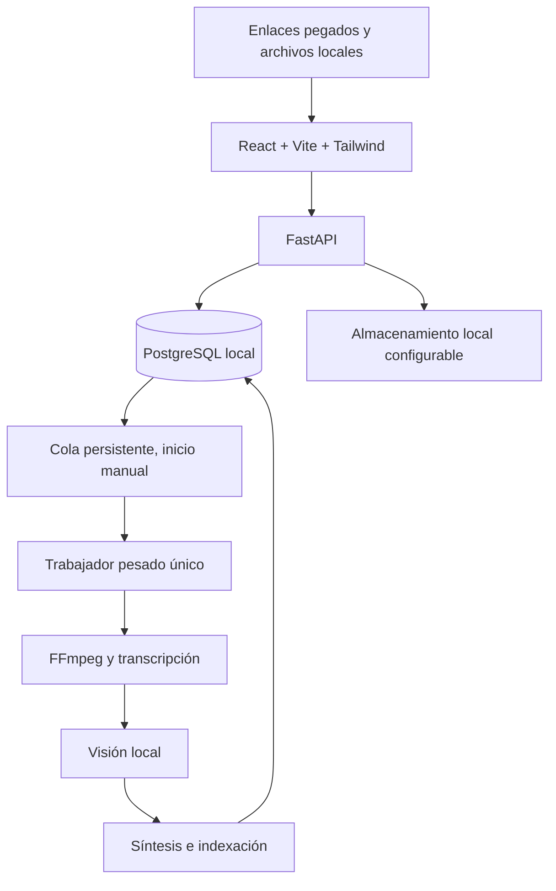

# Arquitectura aprobada

Referencia: plan v1.3, páginas 3-7. El diagrama describe la ruta de escritorio prevista. Fases 1–3 verificadas en su alcance: biblioteca, supervisor manual, audio y ficha audiovisual extractiva en árbol cancelable con reserva pesada. Interfaz React/Vite/Tailwind, API FastAPI y PostgreSQL local. Móvil y Supabase aplazados; búsqueda/chat locales y proyectos no dependen de una bandeja remota. [ADR 0010](decisions/0010-prioridad-escritorio.md).

## Contratos actuales

`GET /api/health` verifica PostgreSQL y revisión Alembic, devuelve estado del motor y disponibilidad del modelo local. `POST /api/sources` guarda URL/título, responde 201 o 409 si existe; si está en papelera incluye `existing_source` para ofrecer restauración. `GET /api/sources?limit=20&offset=0&view=library` entrega página y contadores activos/papelera; `view=trash` consulta eliminados, límite 1–100. `GET /api/sources/{id}` recupera una fuente activa o 404.

`PATCH /api/sources/{id}` recibe título y `expected_updated_at`. `DELETE /api/sources/{id}` recibe un cuerpo JSON con `expected_updated_at` y mueve a papelera; `POST /api/sources/{id}/restore` recibe lo mismo y restaura. Devuelven fuente actualizada con `updated_at`/`deleted_at`. Bloqueo por fila y versión previa; conflicto 409, validación 422, fuente ausente 404 y base no disponible 503. Respuestas no incluyen credenciales ni detalles SQL. No existe borrado físico público. [Detalle de decisiones](decisions/0004-gestion-de-enlaces.md).

Interfaz en `127.0.0.1:5180`, API en `127.0.0.1:8000`. Vite redirige `/api` al backend; no se habilita CORS global. El backend rechaza orígenes externos y hosts no admitidos. Los endpoints de procesamiento exigen acciones explícitas; abrir la aplicación nunca los llama.

## Contratos añadidos en Fase 1

- `POST /api/imports?filename=...`: cuerpo binario, 201 al importar; admite `source_id` y `expected_updated_at` para adjuntar a una fuente. 409 por duplicado/conflicto, 413 por tamaño, 415 por contenedor, 422 por entrada y 507 por escritura fallida. Duplicado de archivo incluye `existing_source`; solo se ofrece restaurar si está en papelera.
- `GET /api/assets/{id}/content`: entrega la copia administrada, con soporte Range; 404 si la fuente está en papelera y 409 si falta la copia o la ruta es inválida.
- `GET /api/organization`: catálogo de nombres e IDs. `PUT /api/sources/{id}/organization`: `tags`, `categories` y `expected_updated_at`, sustituyendo las asociaciones de esa fuente.
- `PUT /api/sources/{id}/queue`: `queued` y `expected_updated_at`; añade/retira de pendientes sin ejecutar procesos.
- El listado de fuentes añade `view=queue`, `q`, `platform`, `source_type`, `tag` y `category`; filtros combinables. Devuelve `queue_total` global y `total` filtrado. Cada fuente incluye `source_type`, URL nullable, activos, etiquetas, categorías y trabajo pendiente/cancelado.

Los archivos pasan por `staging` y se publican por hash antes del commit; bloqueo PostgreSQL por hash y bloqueo/versionado de la fuente. La raíz se configura en el runtime; solo rutas relativas en la base. Detalles y recuperación en [ADR 0005](decisions/0005-cierre-biblioteca.md).

## Responsabilidades

- Frontend: biblioteca, detalle, controles y estados. Solo consume la API; no contiene credenciales de PostgreSQL ni claves privilegiadas de Supabase.
- API: validación, CRUD, consulta, sincronización futura y solicitudes de control. No ejecuta vídeos largos dentro de una petición HTTP.
- Trabajador local: reclama trabajos de PostgreSQL por transacción, conserva checkpoints y coordina una única reserva de recursos pesados.
- Proveedores: adaptadores separados de audio, visión, síntesis, embeddings y chat. Registrar versión, configuración y procedencia.
- PostgreSQL: metadatos, cola, versiones, relaciones y recibos de sincronización. No guardar vídeos completos como filas.
- Archivos: originales y derivados bajo una raíz configurable fuera de OneDrive; rutas relativas comprobadas, cuotas futuras.

## Control y recuperación

Abrir la aplicación deja el motor detenido, incluso si había trabajos activos antes de un fallo. Sincronizar no inicia análisis. Pausar evita nuevos vídeos y lleva el actual a un punto seguro; detener solicita cancelación, guarda lo confirmado y libera recursos. Reanudar o reintentar requiere acción explícita.

Una única tarea pesada incluye al chat: debe esperar o solicitar una pausa mientras el trabajador reserva GPU/RAM. No mantener simultáneamente todos los modelos cargados. Un fallo de IA no impide leer la biblioteca.

## Contrato de información

Cada ficha reúne identificación, clasificación, resumen, transcripción temporal, observaciones visuales, pasos y recursos cuando existan. Cada hallazgo distingue observación de inferencia y verificación externa. Guardar fuente, activo/segmento, tiempo, modelo y versión del análisis. Un trabajo terminado puede producir una ficha parcial: estado operativo y calidad son atributos diferentes.

## Fronteras de red

UI, API y PostgreSQL operan sobre loopback. El producto de escritorio mantiene biblioteca y análisis locales, y no depende de Supabase. Móvil/captura remota quedan aplazados. Recuperar enlaces y verificar páginas requiere conexión; eso no autoriza sincronizar la biblioteca. Si se retoma Supabase más adelante, solo recibiría enlaces pendientes y metadatos mínimos.

## Contratos de audio implementados en Fase 2

- `GET /api/processing`: estado, disponibilidad, fuente activa, modelo y configuración de cómputo.
- `POST /api/processing/start|pause|stop`: inicio/reanudación explícita, pausa al terminar el vídeo y cancelación del actual. 409 si falta modelo o la reserva pesada está ocupada.
- `GET /api/sources/{id}/transcripts`: historial de versiones y segmentos, resultado `speech|no_speech|no_audio` y procedencia. No expone rutas locales. Fuente en papelera devuelve 404.
- La cola incorpora `running|completed|failed|stopped|unavailable` además de `pending|cancelled`, y un mensaje recuperable. Reencolar no inicia ni se incorpora al lote activo.
- Supervisor en hilo de API, inferencia en subproceso por vídeo. Conexión dedicada retiene bloqueo PostgreSQL global. Job Object Windows mata descendientes al cancelar o perder supervisor. No hay servicio de cola adicional ni hilo ejecutando inferencia dentro de HTTP.

[ADR 0006](decisions/0006-audio-motor-manual.md) fija el checkpoint por vídeo, selección de archivo, historial y recuperación. [Evidencias de cierre](verification/phase2.md).

## Contratos audiovisuales — Fase 3 completada en alcance inicial

- `POST /api/processing/start?mode=audiovisual` elige explícitamente audio, visión y síntesis para el lote existente. Sin parámetro conserva audio. Pausa/reanudación eligen modo en el nuevo inicio; no es un modo global persistente. `GET /api/processing` añade `audiovisual_available`; consultar estado no inicia Ollama.
- `GET /api/sources/{id}/analyses` devuelve historial de fichas, cobertura, síntesis con referencias, observaciones, tiempos y procedencia. Papelera devuelve 404. Cada ficha referencia la transcripción y activo de su misma fuente mediante FK compuesta.
- El trabajador conserva la reserva PostgreSQL durante audio y análisis y hasta terminar todos sus descendientes. Audio termina antes de iniciar `ollama serve` propio en 127.0.0.1:11435. Visión permanece cargada entre fotogramas del mismo vídeo y se descarga antes de cargar texto; al terminar se cierra el proveedor propio. Cancelar/caída mata también el servidor y sus ejecutores mediante Job Object.
- Hasta ocho fotogramas distribuidos temporalmente, máximo 768 × 1024, hashes de imagen y tiempos reales; la síntesis usa hasta 12 segmentos de audio. Cobertura siempre parcial. Datos importados sin herramientas/ejecución de comandos; esquema estricto y rechazo de citas inexistentes/respuestas truncadas. Esto valida estructura, no fidelidad factual.
- Transcripción y ficha del intento audiovisual se confirman juntas. Fallar o cancelar no guarda resultados parciales; versiones previas permanecen. Preparación explícita y digests fijados en manifiesto fuera del repositorio. [ADR 0009](decisions/0009-comprension-audiovisual.md).

## Contratos de recuperación — Fase 5

- `GET /api/retrieval/status`: preparación, total de evidencias actuales, fragmentos pendientes de índice y tarea activa. Solo lectura local; no inicia proveedor ni inferencia.
- `POST /api/retrieval/tasks`: acción explícita `index|search|chat`, pregunta de hasta 800 caracteres y sesión opcional. Devuelve 202 e ID. Modelos ausentes, índice pendiente o reserva ocupada: 409. La búsqueda exige indexar todas las evidencias actuales disponibles; no usa versiones superadas silenciosamente.
- `GET /api/retrieval/tasks/{id}` y `POST .../{id}/stop`: consulta ligera y detención. Índice confirmado en una transacción; fallo/detención conserva índice previo. Reinicio marca tareas interrumpidas como detenidas sin retomarlas.
- `GET /api/retrieval/sessions` y `GET .../sessions/{id}`: historial de turnos persistentes. Citas resueltas desde fragmentos inmutables, fuente/versión/tiempo; papelera oculta texto y citas antiguas de chat marcadas como versión anterior.
- Supervisor mantiene el mismo bloqueo pesado PostgreSQL durante embedding, selección y commit. Inferencia en subprocesos sin contraseña de DB y con Job Object. Embedding termina y libera proveedor antes de cargar texto. Selección por IDs cerrados, texto exacto en aplicación, falta de evidencia explícita. [ADR 0011](decisions/0011-busqueda-chat-local.md).

## Vistas y proyectos, primer bloque de Fase 6

Navegación por hash `#library`, `#chat`, `#projects`; Chat conserva estado al cambiar de vista y mantiene contexto limitado del backend existente. `GET/POST /api/projects`, `GET /api/projects/{id}/sources`, `PUT/DELETE /api/projects/{id}/sources/{source_id}`; asociaciones explícitas idempotentes, FK RESTRICT y bloqueo por proyecto para serializar cambios. No eliminan fuentes. Grafo/correcciones trazables pendientes. [ADR 0012](decisions/0012-chat-y-proyectos.md).

## Grafo inicial de Fase 6

`GET /api/projects/{id}/graph`: fuentes activas asociadas y última revisión de cada relación con historial. `POST .../relations` crea propuesta/manual; `PUT .../relations/{relation_id}` añade revisión con expected_version; conflicto 409. Notas de evidencia declaradas por usuario, sin validación factual automática. Fuentes fuera del proyecto o en papelera ocultan relaciones sin borrarlas. No hay tareas pesadas. Cytoscape se carga al abrir proyecto, con lista equivalente para consulta/corrección. [ADR 0013](decisions/0013-grafo-trazable.md).

## Mantenimiento explícito — Fase 7

CLI local sin endpoints de restauración: snapshot PostgreSQL compartido con pg_dump/inventario, medios inmutables por SHA-256 y copia fuera de OneDrive. API detenida y reserva pesada durante backup. Restauración exclusivamente en base/raíz generadas nuevas, validación de tablas y medios antes de marcar verificada. No cambia runtime principal, no inicia IA ni incorpora modelos/secretos. [ADR 0014](decisions/0014-recuperacion-entrega-local.md).

## Producto personal integrado — 2026-11-01

La capa notebook conserva apuntes humanos y citas versionadas; retrieval_data incorpora solo revisiones actuales activas al índice. Cada lote de 128 fragmentos se confirma en una transacción y se puede retomar por nueva orden manual. Chat mantiene tres preguntas previas y filtros por pertenencia actual al proyecto/fuentes. La respuesta explicativa local exige cita literal por afirmación y verificación; ante salida no válida usa selección extractiva. Esto no acredita veracidad factual. Saludos/ayuda se resuelven sin IA.

Las acciones de biblioteca por selección son atómicas. La reserva transaccional de organización ordena altas/renombres/asociaciones de etiquetas; Source.updated_at sigue protegiendo formularios antiguos. El grafo añade apuntes versionados y una lista navegable hacia originales. Se preservan transcripciones, análisis y relaciones anteriores.

El diagnóstico web es de lectura (más renombrado de taxonomía/exportación), sin endpoint para ejecutar scripts. Mantenimiento es una ventana Tkinter iniciada por el usuario y separada del árbol de API/frontend; usa los scripts propios, espera detención y conserva los intentos. Activar una copia verificada cambia únicamente DataRoot/DatabaseName y guarda configuración anterior. No mueve credenciales ni originales. [ADR 0016](decisions/0016-conocimiento-personal-y-operacion.md).
