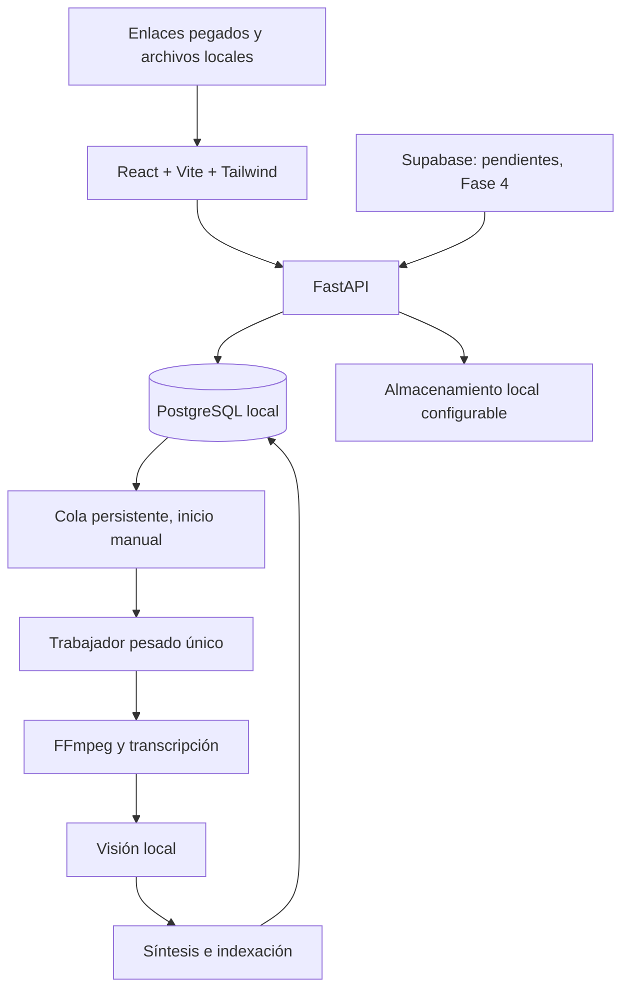

# Arquitectura aprobada

Referencia: plan v1.3, páginas 3-7. Este documento describe el sistema previsto; no acredita implementación.

## Responsabilidades

- Frontend: biblioteca, detalle, controles y estados. Solo consume la API; no contiene credenciales de PostgreSQL ni claves privilegiadas de Supabase.
- API: validación, CRUD, consulta, sincronización futura y solicitudes de control. No ejecuta vídeos largos dentro de una petición HTTP.
- Trabajador local: reclama trabajos de PostgreSQL por transacción, conserva checkpoints y coordina una única reserva de recursos pesados.
- Proveedores: adaptadores separados de audio, visión, síntesis, embeddings y chat. Registrar versión, configuración y procedencia.
- PostgreSQL: metadatos, cola, versiones, relaciones y recibos de sincronización. No guardar vídeos completos como filas.
- Archivos: originales y derivados bajo una raíz configurable fuera de OneDrive; rutas relativas comprobadas, cuotas futuras.

## Control y recuperación

Abrir la aplicación deja el motor detenido, incluso si había trabajos activos antes de un fallo. Sincronizar no inicia análisis. Pausar evita nuevos vídeos y lleva el actual a un punto seguro; detener solicita cancelación, guarda lo confirmado y libera recursos. Reanudar o reintentar requiere acción explícita.

Una única tarea pesada incluye al chat: debe esperar o solicitar una pausa mientras el trabajador reserva GPU/RAM. No mantener simultáneamente todos los modelos cargados. Un fallo de IA no impide leer la biblioteca.

## Contrato de información

Cada ficha reúne identificación, clasificación, resumen, transcripción temporal, observaciones visuales, pasos y recursos cuando existan. Cada hallazgo distingue observación de inferencia y verificación externa. Guardar fuente, activo/segmento, tiempo, modelo y versión del análisis. Un trabajo terminado puede producir una ficha parcial: estado operativo y calidad son atributos diferentes.

## Fronteras de red

UI, API y PostgreSQL operan sobre loopback. La biblioteca almacenada funciona sin Supabase. Recuperar enlaces y verificar páginas requiere conexión. Supabase no ejecuta IA ni almacena la biblioteca completa.
