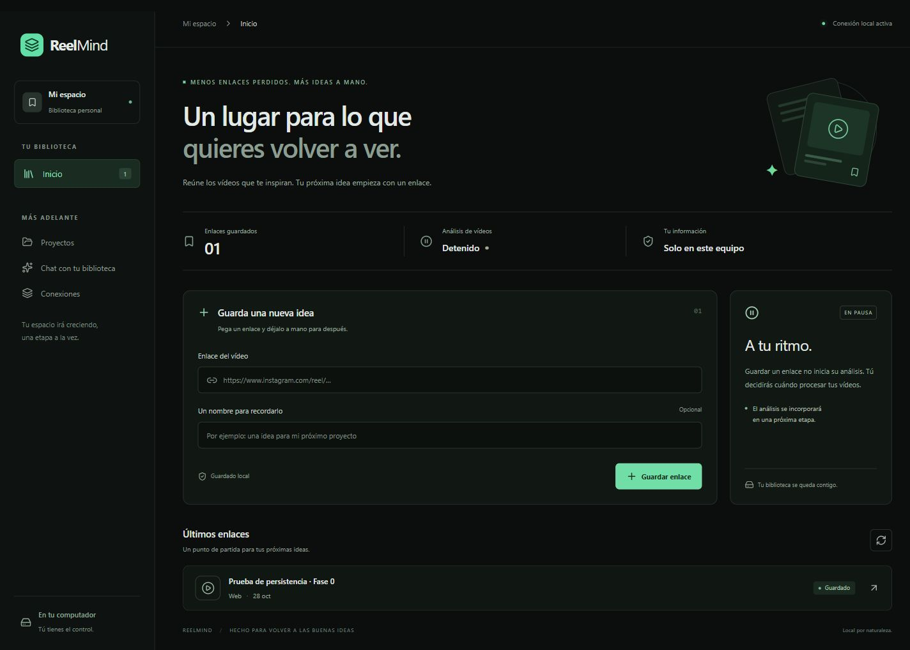
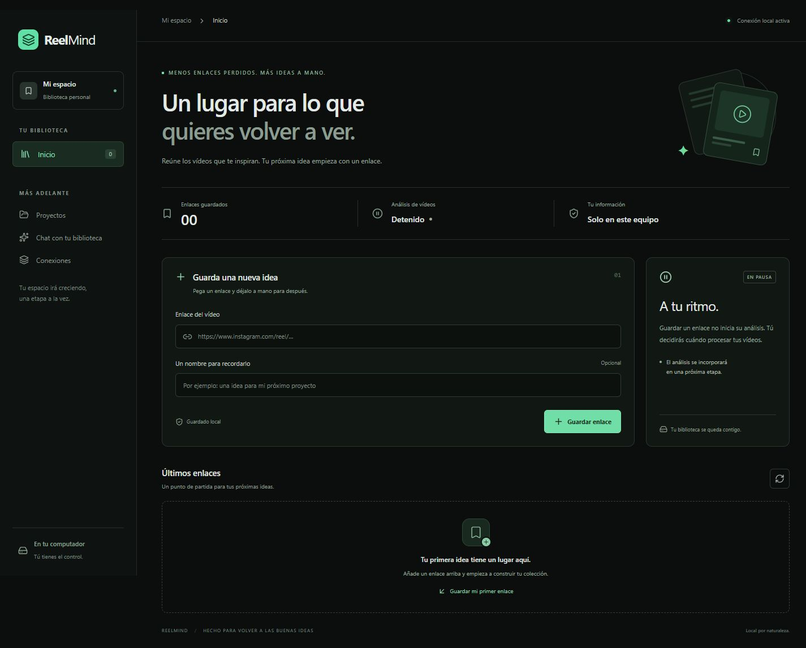

# Verificación de Fase 0

Fecha: 2026-10-28. Entorno: Windows del usuario, PostgreSQL 18.6 local, interfaz en 5180 y API en 8000.

| Prueba | Resultado |
| --- | --- |
| Instalación desde dependencias fijadas | Correcta: `setup.ps1`, `npm ci`, requisitos Python fijados |
| Compilación TypeScript + Vite | Correcta; artefactos en `frontend/dist`, excluidos de Git |
| Consistencia de dependencias Python | `pip check`: sin dependencias rotas |
| Integración con PostgreSQL | 19 pruebas aprobadas en esquemas temporales aislados |
| Migración | `0001_sources` aplicada tras respaldo; `alembic check` sin diferencias |
| Escritura desde navegador | Formulario guarda URL y título; contador 1 y fila visible |
| Duplicado desde navegador | Mensaje de enlace existente; sigue un solo registro |
| Desconexión | Aviso visible y botón de guardar deshabilitado |
| Reinicio | Frontend y API detenidos; PostgreSQL reiniciado; mismo ID/URL/título recuperados |
| Estado del motor | `state=stopped`, `autostart=false`, `available=false`, `concurrency=1` antes/después |
| Alcance de red | 8000 y 5180 en 127.0.0.1; PostgreSQL en loopback |
| Diseño adaptable | Revisado a 1440 y 390 px, sin desbordamiento horizontal |
| Limpieza de prueba | Se retiró exclusivamente el registro creado para verificar el flujo |

## Evidencia de persistencia

Se guardó desde la UI `https://example.com/reelmind-fase0-prueba` con título «Prueba de persistencia · Fase 0». ID asignado: `063746fd-6653-45ab-8bb5-5dcaac0d2770`. Se recuperó el mismo registro tras reiniciar ambos servicios de la app y PostgreSQL. El registro no representa un vídeo real ni un análisis realizado.

## Estado listo para el usuario

## Repetir comprobaciones

Desde la raíz: `powershell -NoProfile -File .\scripts\backend.ps1 -Action Test` y `-Action Check`. Para UI, iniciar ReelMind y probar un enlace propio. Las pruebas automáticas nunca vacían la biblioteca del usuario.

## Límites de esta evidencia

Se reiniciaron procesos y el servicio PostgreSQL; no se reinició Windows. El comportamiento tras reiniciar Windows se deriva del inicio manual de ReelMind, pero no se acredita una prueba completa del sistema operativo. No se ha evaluado IA, descargado vídeos, integrado Supabase ni ensayado restauración completa de biblioteca/medios. Las pruebas reportan una advertencia de deprecación de `httpx` en el adaptador de Starlette; no fallos.
