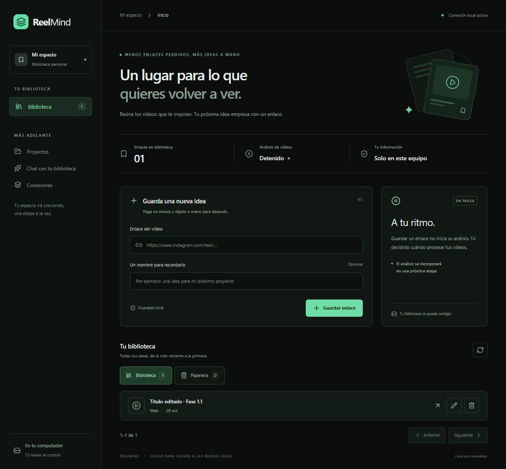

# Verificación de Fase 1.1 — gestión de enlaces

Fecha: 2026-10-29, America/Santiago. Resultado: bloque 1.1 completado; Fase 1 en curso.

## Pruebas automatizadas

`powershell -NoProfile -File .\scripts\backend.ps1 -Action Test`: **34 aprobadas** (19 existentes y 15 nuevas). Cada prueba usa un esquema PostgreSQL temporal aislado; no limpia tablas de usuario.

| Comprobación | Resultado |
| --- | --- |
| Editar título, recortar espacios, vaciarlo y preservar URL/identidad/fecha de creación | Aprobada; visible desde conexión nueva |
| Eliminar lógicamente, consultar papelera y restaurar | Aprobada; misma fila y datos; sin duplicación |
| Reintentos de eliminación/restauración | Aprobada; idempotentes |
| Alta duplicada de un enlace en papelera | Aprobada; ofrece fuente original para restaurar |
| Paginación de 41 filas con fechas iguales | Aprobada; orden determinista, sin omisiones en conjunto estable |
| Retirar último elemento de última página | Aprobada; ajusta desplazamiento |
| Páginas inválidas, títulos largos, campos extra y versión ausente | Rechazados sin modificar datos |
| Ediciones concurrentes de la misma versión | Una gana, otra devuelve 409; datos no sobrescritos |
| Edición/eliminación con versión antigua | Rechazada con 409 |
| Fuentes inexistentes, orígenes externos y motor detenido | Comportamiento esperado |

`npm.cmd run build`: TypeScript y Vite aprobados. `backend.ps1 -Action Check`: sin diferencias de esquema. No se modificó ni se añadió una migración.

Aviso no bloqueante: continúa el aviso de deprecación del adaptador httpx de Starlette ya registrado en Fase 0.

## Recorrido real en navegador

1. Crear un enlace temporal, editar su título y verificarlo en la lista.
2. Abrir eliminación y cancelar: registro conservado. Confirmar eliminación: biblioteca sin el registro, papelera con él.
3. Intentar guardar la misma URL: mensaje y acción de restauración; restaurar mantiene el título editado.
4. Añadir 20 registros temporales identificados para tener 21. Siguiente muestra el registro 21; retirarlo ajusta la vista a 1–20 de 20. Consultar la papelera.
5. Reiniciar los procesos de frontend y API. Comprobar por API el mismo ID, título editado, fechas y estado de papelera. PostgreSQL siguió activo; no se reinició Windows ni el servicio de base en este bloque.
6. Restaurar desde la papelera. Revisar pantalla de 390 × 844 y escritorio de 1223 px, sin desbordamiento horizontal. Diálogo con foco en el campo al editar y cierre con Escape; cancelación sin cambios.
7. Retirar los 21 registros de prueba mediante coincidencia de ID, URL y título en una transacción. No tocar registros ajenos. Verificar biblioteca y papelera sin registros de prueba y dejar ReelMind iniciado.

El motor permaneció detenido. No se abrieron los enlaces de prueba ni se descargó su contenido.

## Evidencia visual

La captura muestra un registro temporal de verificación, retirado al finalizar.

## Límites

Los archivos, etiquetas/categorías, búsqueda/filtros y cola siguen pendientes. La papelera no tiene purga. No se probó restauración desde respaldo ni se reevalúan modelos o dependencias en este bloque. La paginación no congela el conjunto entre peticiones de ventanas distintas.
